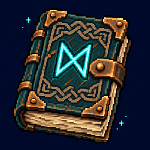

# New Game Deluxe

Valheim already comes with a Viking. Now the Viking comes with a class.

Play a spell-slinging Mage or a Fury-fueled Berserker, level from 1 to 40, and trade boss trophies for promotions. Early access.

**[Download on Thunderstore](https://thunderstore.io/c/valheim/p/NewGameDeluxe/New_Game_Deluxe/)** | **[Report a bug](../../issues/new?template=bug_report.yml)** | **[Give feedback](../../issues/new/choose)**

## Available now

- **Mage.** Fire, frost or lightning. Elemental companion included.
- **Berserker.** Melee hits build Fury. Spend it to hit harder. Works with any melee weapon.
- Talent choices, mastery upgrades and boss-trophy promotions for both, levels 1 to 40.

In the works: Necromancer and Ranger, and levels 41 to 50.

Install with a mod manager, press F7 in game and pick a class. Controls, settings and the changelog are on the [Thunderstore page](https://thunderstore.io/c/valheim/p/NewGameDeluxe/New_Game_Deluxe/).

## Good to know

- Do not combine with other class or leveling mods (Valheim Ascended, ComputerClasses, Oathbound, EpicMMOSystem or anything built on it).
- Tested in single player only. On a server, everyone needs the same version. Dedicated servers are untested.
- A character that has reached rank 4 or picked a level 40 talent can't be loaded by 0.2.x or older. Don't roll back.

## Reporting

Pick the form that fits:

- **Bug report:** something is broken, crashes or confuses you.
- **Balance and feel:** something is too strong, too weak, too slow or just feels off.
- **Idea:** something you would like to see.

Not sure which? Use the bug report.

A log helps a lot with bugs, but send the report even if you can't find it. The file is `LogOutput.log` in the `BepInEx` folder of your profile. In r2modman: Settings > Browse profile folder.

## About this repository

This is only a public tracker for bug reports, feedback and ideas. The mod's source code is not hosted here.

Made with AI assistance. Press Pause Garage LLC.

Not affiliated with Iron Gate or Coffee Stain. Valheim is a trademark of its owner.
